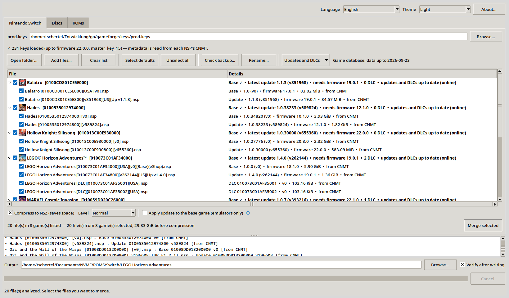
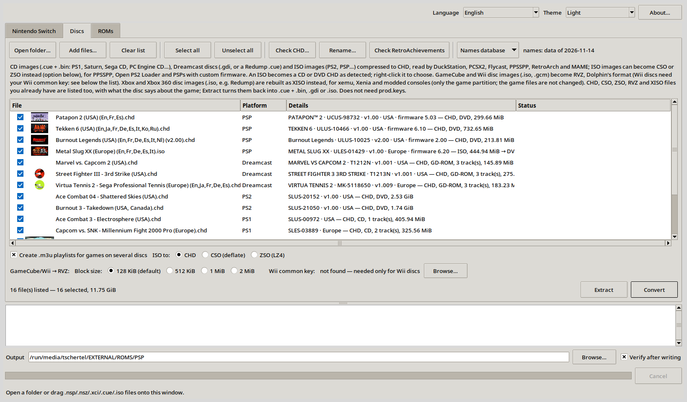
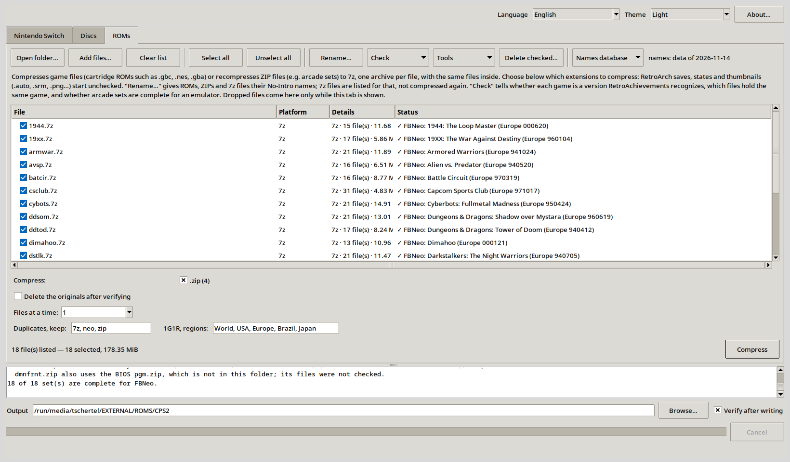

# GameForge

[Português (Brasil)](README.pt-BR.md)

**Compress, verify and organize backups of the games you own**: Nintendo Switch, disc-based consoles and cartridge ROMs, in one small desktop app for Windows and Linux (macOS experimental). There is nothing to install, it is one file, and it needs no other tools.

Current version: **2.18.0**. [Download](#download) · [Full guide](docs/GUIDE.md) · [What's new](CHANGELOG.md)

## What it does

### Nintendo Switch

- **Merges** the base game, its update and its DLCs (NSP, NSZ or XCI) into **one file**.
- **Compresses to NSZ** while merging, usually 30–50% smaller. Installers rebuild the original files byte for byte. It also decompresses NSZ back to NSP.
- **Checks a backup**: every file is hashed and compared with what the package says it holds.
- **Updates and DLCs ▾** compares your games with an online database, to tell which updates or DLCs are missing.
- **Renames** files to `Name [TitleID][vVersion].nsp`.

It needs your own `prod.keys` in the `keys` folder.

### Discs

For PS1, PS2, PSP, Saturn, Sega CD, Dreamcast, GameCube, Wii, Xbox and more:

- **Converts** CUE/BIN, GDI and ISO to **CHD**, ISOs to **CSO/ZSO**, GameCube and Wii discs to **RVZ**, and Xbox discs to **XISO**. **Extract** turns CHDs back into CUE/BIN, GDI or ISO.
- **Shows what each disc is**: product code, region, version, and the icon or disc label.
- **Renames** discs with their **Redump** names.
- **Checks RetroAchievements**: whether your version of each game has achievements.

### ROMs

- **Compresses** ROMs to **7z**, one archive per game, and recompresses arcade ZIPs.
- **Renames** ROMs with their **No-Intro** names, finds **duplicates** and keeps **one version per game** (1G1R) by your preferred regions.
- **Checks arcade sets** for FBNeo, the RetroArch MAME cores and Flycast (NAOMI, Atomiswave), and tells the AES and MVS versions of Neo Geo games apart.
- **Checks RetroAchievements**. A click on the status of an unsupported version opens the list of the versions RetroAchievements accepts, and each check saves an HTML report.
- **Tools** trim Nintendo DS ROMs and convert Nintendo 64 ROMs to `.z64`.

## Download

Get the file for your system from [Releases](https://github.com/tschertel/gameforge/releases/latest), unzip it and run it:

| System | File |
|---|---|
| Windows (64-bit) | `gameforge-X.Y.Z-windows-amd64.zip` → `gameforge.exe` |
| Linux (64-bit) | `gameforge-X.Y.Z-linux-amd64.tar.gz` → `./gameforge` |
| macOS (experimental, untested) | `gameforge-X.Y.Z-macos-arm64.tar.gz` (Apple Silicon) or `-amd64` (Intel) |

For Switch games, put your `prod.keys` in the `keys` folder next to the program. For Wii discs, also put the Wii common key there. Disc images and ROMs need no keys.

## Good to know

- **Careful with your files**: results are written under a temporary name and **verified after writing**. Renaming shows the changes first and never writes over a file. An original is replaced or removed only by an option or tool that says so, after the new file has been read back.
- **The name databases** (Redump, No-Intro, arcade sets, RetroAchievements) are downloaded the first time they are needed, after asking, and kept in a `cache` folder.
- **English, Portuguese, German, French and Spanish**, with light and dark themes.
- **An optional check for new versions**, which asks first. It sends only the app's name and version.
- **No games and no keys** are included: use it only with games you own and keys from your own console.

## More

- **[Full guide](docs/GUIDE.md)**: every option, file formats, settings and limitations.
- **[Building from source](docs/GUIDE.md#building)**: Go, without a C compiler.
- **[Changelog](CHANGELOG.md)**.

## License

[MIT](LICENSE). Third-party licenses are in [THIRD_PARTY_LICENSES.txt](THIRD_PARTY_LICENSES.txt). The Redump and No-Intro databases are downloaded by the app and are not part of this repository.
