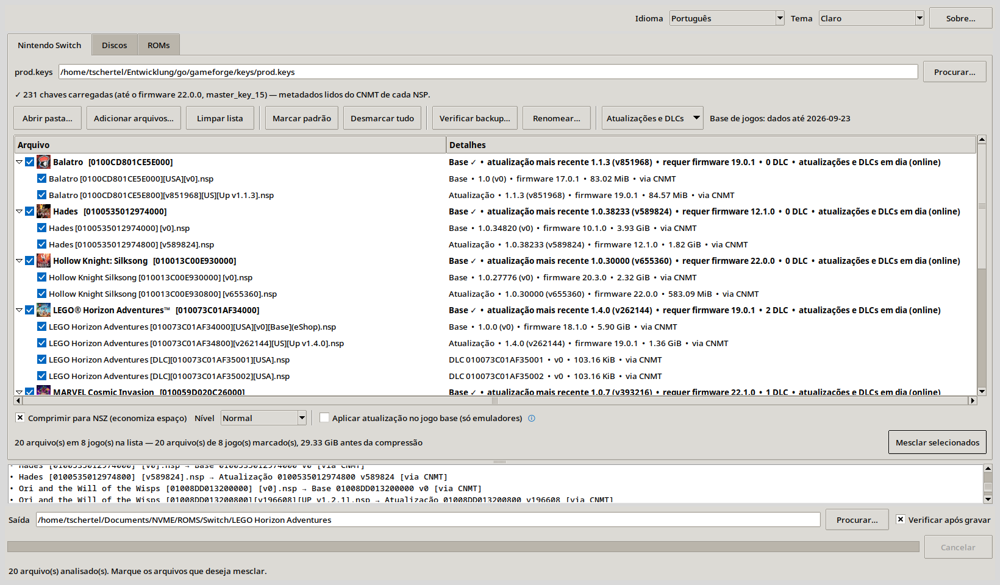
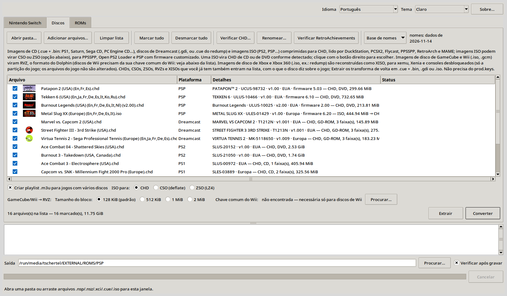
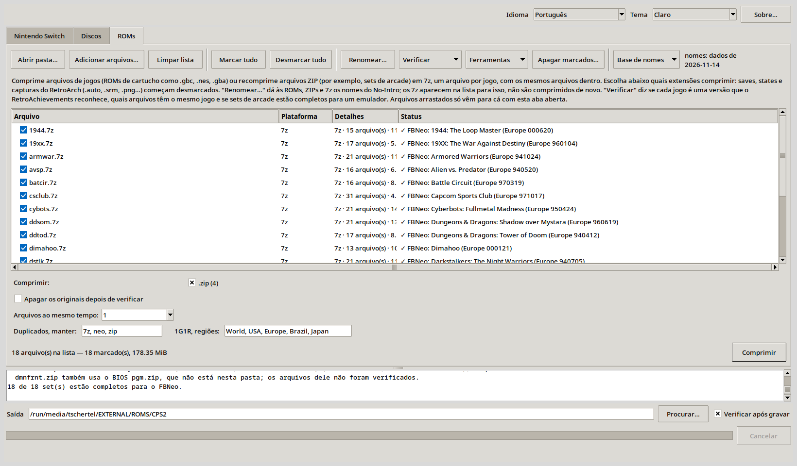

# GameForge

[English](README.md)

**Comprima, verifique e organize cópias de segurança dos jogos que você tem**: Nintendo Switch, consoles de disco e ROMs de cartucho, num app pequeno para Windows e Linux (macOS experimental). Não precisa instalar nada: é um arquivo só e não depende de outras ferramentas.

Versão atual: **2.18.0**. [Download](#download) · [Guia completo](docs/GUIDE.pt-BR.md) · [Novidades](CHANGELOG.md)

## O que ele faz

### Nintendo Switch

- **Junta** o jogo base, a atualização e os DLCs (NSP, NSZ ou XCI) num **arquivo só**.
- **Comprime em NSZ** ao juntar, em geral de 30% a 50% menor. Os instaladores refazem os arquivos originais byte a byte. Também descomprime NSZ de volta para NSP.
- **Verifica uma cópia**: calcula o hash de cada arquivo e compara com o que o pacote diz ter.
- **Atualizações e DLCs ▾** compara os seus jogos com uma base de dados online e mostra que atualizações ou DLCs faltam.
- **Renomeia** os arquivos para `Nome [TitleID][vVersão].nsp`.

Precisa do seu próprio `prod.keys` na pasta `keys`.

### Discos

Para PS1, PS2, PSP, Saturn, Sega CD, Dreamcast, GameCube, Wii, Xbox e outros:

- **Converte** CUE/BIN, GDI e ISO para **CHD**, ISOs para **CSO/ZSO**, discos de GameCube e Wii para **RVZ** e discos de Xbox para **XISO**. **Extrair** transforma os CHDs de volta em CUE/BIN, GDI ou ISO.
- **Mostra o que é cada disco**: código do produto, região, versão e o ícone ou a etiqueta do disco.
- **Renomeia** os discos com os nomes do **Redump**.
- **Verifica no RetroAchievements** se a sua versão de cada jogo tem achievements.

### ROMs

- **Comprime** ROMs em **7z**, um arquivo por jogo, e recomprime ZIPs de arcade.
- **Renomeia** ROMs com os nomes do **No-Intro**, encontra **duplicados** e mantém **uma versão de cada jogo** (1G1R) pela sua ordem de regiões.
- **Verifica sets de arcade** para o FBNeo, os cores de MAME do RetroArch e o Flycast (NAOMI, Atomiswave), e diferencia as versões AES e MVS dos jogos de Neo Geo.
- **Verifica no RetroAchievements**. Um clique no status de uma versão não suportada abre a lista das versões que o RetroAchievements aceita, e cada verificação grava um relatório em HTML.
- **Ferramentas** cortam ROMs de Nintendo DS e convertem ROMs de Nintendo 64 para `.z64`.

## Download

Baixe o arquivo do seu sistema em [Releases](https://github.com/tschertel/gameforge/releases/latest), descompacte e execute:

| Sistema | Arquivo |
|---|---|
| Windows (64 bits) | `gameforge-X.Y.Z-windows-amd64.zip` → `gameforge.exe` |
| Linux (64 bits) | `gameforge-X.Y.Z-linux-amd64.tar.gz` → `./gameforge` |
| macOS (experimental, não testado) | `gameforge-X.Y.Z-macos-arm64.tar.gz` (Apple Silicon) ou `-amd64` (Intel) |

Para jogos de Switch, coloque o seu `prod.keys` na pasta `keys`, ao lado do programa. Para discos de Wii, coloque lá também a chave comum do Wii. Imagens de disco e ROMs não precisam de chaves.

## Bom saber

- **Cuidado com os seus arquivos**: os resultados são gravados com um nome temporário e **verificados após gravar**. A renomeação mostra as mudanças antes e nunca escreve por cima de um arquivo. Um original só é substituído ou apagado por uma opção ou ferramenta que diz isso, depois que o arquivo novo é lido de volta.
- **As bases de nomes** (Redump, No-Intro, sets de arcade, RetroAchievements) são baixadas na primeira vez que forem necessárias, depois de perguntar, e ficam numa pasta `cache`.
- **Inglês, português, alemão, francês e espanhol**, com temas claro e escuro.
- **Verificação opcional de novas versões**, que pergunta antes. Envia só o nome e a versão do app.
- **Não inclui jogos nem chaves**: use só com jogos que você tem e chaves do seu próprio console.

## Mais

- **[Guia completo](docs/GUIDE.pt-BR.md)**: todas as opções, formatos de arquivo, configurações e limitações.
- **[Compilar o código](docs/GUIDE.pt-BR.md#compilação)**: Go, sem compilador C.
- **[Histórico de mudanças](CHANGELOG.md)** (em inglês).

## Licença

[MIT](LICENSE). As licenças de terceiros estão em [THIRD_PARTY_LICENSES.txt](THIRD_PARTY_LICENSES.txt). As bases do Redump e do No-Intro são baixadas pelo app e não fazem parte deste repositório.
